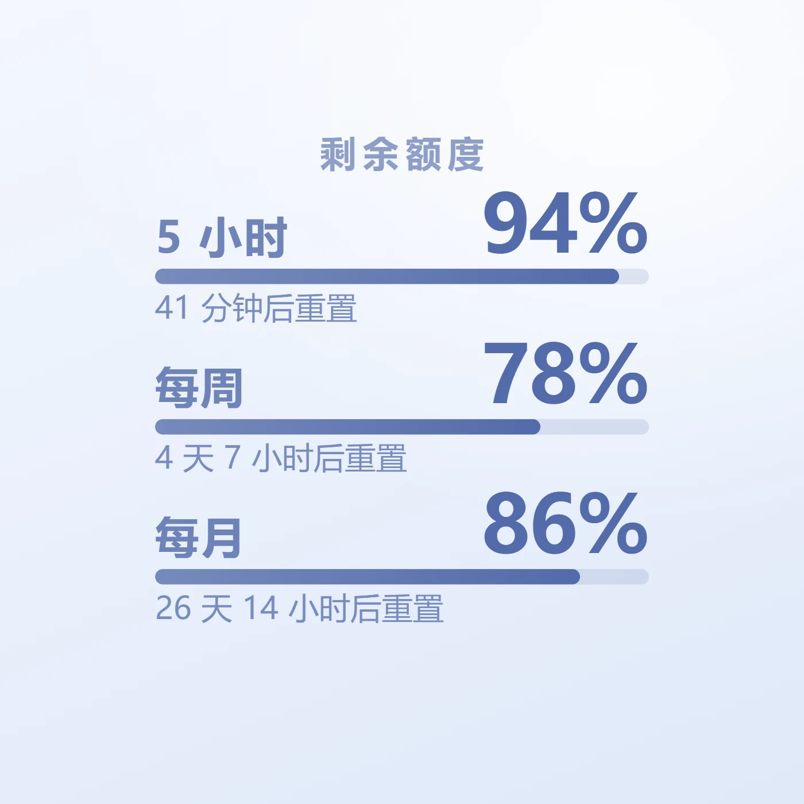

# dsh-whale-widget-planbar

给 [dsh-whale-widget](https://github.com/MeteorNOX/DeepSeek-Balance-Whale-Widget)（DSH 界面右下角的小鲸鱼挂件）
的泡泡加一种模块：**订阅额度卡片** —— 把 OpenCode Go 的 5h / 周 / 月，或智谱 / Kimi 的双窗口，
画成「小标题 + 大号剩余百分比 + 细进度条 + 重置倒计时」，一眼看出还剩多少。

> **非官方补丁**：与上游作者没有隶属关系；本仓库不发布 npm 包，也不再分发上游的美术素材。
> 只支持 **dsh-whale-widget 0.4.2**；上游一升级，补丁锚点就可能失效，需要重新核对。



*卡片本体渲染：补丁后的 `bubblePlanBarEl()` + 桩数据，省略气泡外框与角色原画。*

## 装

需要 PowerShell 7（`pwsh`）。

```powershell
# 插件没装会先装上游 0.4.2；dsh 不在 PATH 时加 -DshCmd 指定
pwsh -File .\install.ps1
```

装完刷新 DSH 界面，点小鲸鱼 → ☰，底部版本号应显示 **`v0.4.2+planbar2`**。

自定义 DSH_HOME / profile：

```powershell
pwsh -File .\install.ps1 -DshHome "<你的 DSH_HOME>" -Profile desktop
```

只打补丁、不碰安装流程（已装好插件时）：

```powershell
pwsh -File .\apply-planbar.ps1 -Target "$env:DSH_HOME\profiles\desktop\node_modules\dsh-whale-widget\assets\whale-widget.js"
```

`DSH_HOME` 的解析顺序：`-DshHome` → `$env:DSH_HOME` → `$HOME/.dsh`。

## 用

1. 刷新页面（`Ctrl+R` / `Ctrl+Shift+R`；版本号没变就重启一次 DSH）；
2. 点小鲸鱼 → ☰ →「按压泡泡设置」；
3. 模块库里点 **「额度条·OpenCode Go（订阅）」**（多窗口额度模型旁都有这个芯片）；
4. 保存。

鼠标悬停每一行可以看到「已用 X% · 剩余 Y% · 重置」。超过 3 个窗口时只画前 3 块，完整数据在卡片 tooltip 里。

## v1 → v2 改了什么

| | v1（旧） | v2（当前） |
|---|---|---|
| 信息层级 | 窗口名 + 「百分比 · 倒计时」一行 | 小标题 / 大号数字 / 细条 / 小字倒计时 四级 |
| 百分比 | 已用 | **剩余**（94% / 78% / 86%） |
| 进度条 | 黑底半透明轨道 + 纯色填充 | 圆角轨道 + 同色渐变，轨道 = 文字色 15% |
| 配色 | 写死 `#7fa8d8` | 从泡泡文字色推导，跟随皮肤 / 自定义 `textColor` |
| 宽度 | 先用 rAF 拉到 textBox 满宽（677u），椭圆上下端被描边裁掉 | 固定 384u 居中 |
| 多窗口 | 3 行平铺 | 3 块竖排；≤2 窗口居中，3 窗口整卡上移 18u |
| 版本标识 | `v0.4.2+planbar` | `v0.4.2+planbar2` |

## 设计要点

- **颜色**：`mod.color` → 泡泡文字色（`getComputedStyle(hostEl).color`）→ 默认 `#536ba9`；
  轨道用 `rgba(base, .15)`，数字用 `base`，辅助字 `.64~.75`。
- **宽度**：经典椭圆框在上下 1/4 处只剩约 420u 的干净宽度，所以固定 384u，不再读容器宽
  （v1 的 `requestAnimationFrame` 拉满正是裁切的来源）。
- **窗口数量**：OpenCode Go 是 3 个；智谱 / Kimi 是 2 个。超过 3 个只画前 3 块。
- **字号**：卡片内部尺寸全部是 `--dshw-u` 的倍数，跟着挂件缩放；百分比最多保留两位小数
  （`6.25%` 不会变成 `6.3%`），按最长的一行统一缩字号（整数 62u → 一位/两位小数 56u → 更长 50u）。
- **倒计时**：本地按分钟 / 小时 / 天格式化（`4 天 10 小时后重置`；不足 1 小时显示 `30 分钟后重置`）。
- **数据**：仍用挂件自带的 `apiPlanOf(modelId)`，**没有新增任何网络请求**。

## 验证记录

- 上游 0.4.2 原版 `assets/whale-widget.js` sha256：`7B9AC4808896B68F835D2924217193ECF57F840F872FB4EA84CA028AE7172DEB`
- 打上 v2 后 sha256：`006B635D1143C22D5DBCF3C889F0A18903233462F45FC2F832C8B91CA7E54550`
- 用原版 + `pairs.json` + `apply-planbar.ps1` 从零重打，产物与上面一致，`node --check` 通过。
- `planbar.patch` 由原版与安装文件用 `git diff` 生成；`git -c core.autocrlf=false apply` 后 sha256 同样是
  `006b635d…`（Windows 默认 `autocrlf` 时会写成 CRLF，功能不受影响，但哈希会变）。
- `docs/preview.html` 用补丁后的真实 `bubblePlanBarEl()` 配桩数据（3 窗口）在 headless Chrome 里渲染，
  卡片在 700×700 画布内不裁切；开发时也跑过 2 窗口 / 读取失败态（截图未入库）。
- 没有改动既有模块的渲染路径，只新增 `planbar` 分支。

## 已知限制

- 模块编辑器里 `planbar` 仍会显示通用的「内容」输入框（对卡片无效），也没有「显示样式」下拉；
  `planWin` 字段仍可手工写进配置（v1 就有的缺口）。
- 模块的 `size` 档位对卡片无效（v2 用固定比例）。
- 固定 384u 是按经典椭圆框调的；自定义泡泡框安全区特别小时，卡片可能压到描边。
- 这是**改第三方包**，不是插件：上游更新会覆盖，需要重打；补丁也只对 0.4.2 负责。

## 回滚

```powershell
pwsh -File .\install.ps1 -Restore
```

或直接重装上游：

```powershell
dsh plugin --profile desktop add dsh-whale-widget@0.4.2
```

重装插件目录会整体替换，补丁和备份都会没有，所以长期回滚靠重装。

## 为什么是补丁，不是整包

上游代码是 MIT，允许修改和再发布；但上游 `PROVENANCE.md` 明确 `assets/**` 的美术素材
（图片 / 动图 / 音效）与 `icon.png` **不在 MIT 覆盖范围内**、不授予再许可。
把「改好的整个插件」传上来，等于替上游再分发他们无权转授的素材；发布 npm 同名包更不可能。
所以这里只放**文本替换 + 应用脚本**：素材由用户自己从上游装，补丁只改代码。
预览图也是用补丁后的函数配桩数据渲染的卡片本体，不含角色原画。

## 和上游的关系

上游 [issue #156](https://github.com/MeteorNOX/DeepSeek-Balance-Whale-Widget/issues/156)
（2026-09-25，仍 open）和 PR [#280](https://github.com/MeteorNOX/DeepSeek-Balance-Whale-Widget/pull/280)、
[#319](https://github.com/MeteorNOX/DeepSeek-Balance-Whale-Widget/pull/319) 都在做「多窗口额度进度条」，
目前都没合并。本补丁是另一份独立实现（新增 `planbar` 模块类型），不是它们的替代，
也不打算替上游做决定。如果上游合了同类功能，建议直接用上游并卸掉本补丁。

## 开发

`planbar.patch` 是相对上游 0.4.2 的参考 diff（`git apply` 可直接复现）；`pairs.json` 由它生成：

```powershell
node tools/gen-pairs.mjs planbar.patch pairs.json
```

`pairs.json` 是 7 组替换，其中 1 组重复（同一段代码出现在两个函数里），脚本按内容去重后实际替换 6 次。
`apply-planbar.ps1` 只做逐段「查找 → 替换」：幂等（含标记就跳过）、锚点缺失即报错、
写入保持原换行风格、最后跑一次 `node --check`。改补丁时同步更新 `pairs.json` 与版本号后缀。

`docs/preview.html` 是从打过补丁的 bundle 里抽出 `bubblePlanBarEl()`，配最小桩函数
（`apiPlanOf` / `apiModelById` / `bubblePlanWinOf` / `apiPlanResetMs`）渲染的，改完样式可以重开截图。

## 许可

补丁、脚本与文档按 **MIT** 发布，见 [LICENSE](LICENSE)；其中包含的上游代码片段
（`Copyright (c) 2026 MeteorNOX`）仍按其 MIT 许可使用。美术素材不在本仓库内，
来源与排除范围见 [NOTICE.md](NOTICE.md)。
